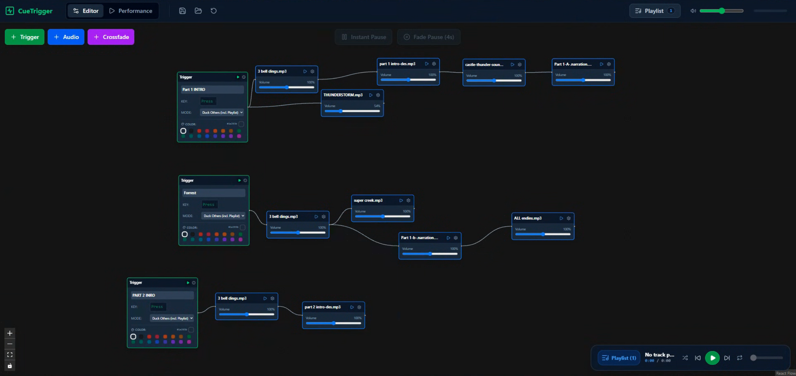
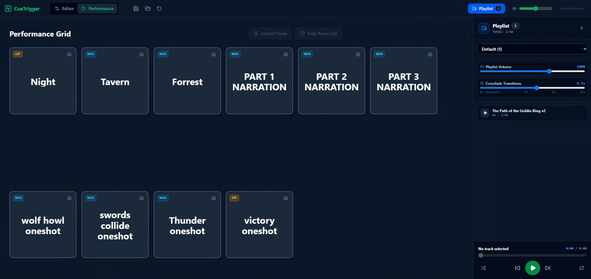

# CueTrigger

A browser-based sound cue app for anything live. You build cues in a node editor (trigger → audio → crossfade → audio…), then run the show from a grid of big colored tiles that you fire by clicking or by pressing a key. A background-music playlist runs alongside the cues.

Everything runs locally in your browser. No account, no internet connection, and no server beyond the small one that serves the app on your own computer.


*Editor mode: each trigger plays the chain of audio nodes connected after it.


*


*Performance mode: fire cues from the tile grid while the playlist runs alongside.*

---

## What it's for

Anywhere one person needs to fire sounds on cue, with music running underneath.

- **Tabletop RPGs (D&D and others):** ambient scene loops (tavern, forest, dungeon), combat stingers, one-shot effects like doors, spells and thunder, and a music bed that ducks under your narration.
- **Theater and live productions:** sound effects, scene-change music and pre-show music, with Cut cues for hard transitions and Duck cues for effects over underscoring.
- **Live events and MCing:** walk-on music, award stingers, applause cues and announcements over a background playlist.
- **Podcasts and live streams:** intros, outros, transitions and sound-board drops.
- **Haunted attractions and escape rooms:** room ambiences and jump-scare or puzzle-solved effects, triggered by an operator.
- **Classrooms and presentations:** quick sound examples, quiz-show buzzers, and timer or break music.
- **Trade-show booths:** looping background audio with demo cues on top.
- **Radio drama and audio storytelling:** layered effects and music cues performed live.
- **Soundscapes and installations:** layered ambient loops you can shift live.

---

## Install and run

You need [Node.js](https://nodejs.org) 18 or newer.

```bash
npm install
npm run dev
```

Then open **http://localhost:3000** in Chrome or Edge.

Click the amber **"AUDIO NOT RUNNING"** bar (or anywhere in the app) once after opening. Browsers don't allow sound until you've interacted with the page.

**Open it from another computer on the same network:** use `http://<this-computer's-IP>:3000`. Note that each address keeps its own copy of the show (see [Saving and loading](#saving-and-loading-shows)), and sound plays out of whichever computer has the page open.

**Production build (optional):**

```bash
npm run build
npm run preview
```

`preview` serves on a different port (4173), which counts as a different address, so load your show file there.

---

## The two modes

Switch with the **Editor / Performance** buttons at the top.

### Editor mode: build the show

- **Add nodes** with the **+ Trigger / + Audio / + Crossfade** buttons, or **right-click** empty canvas to add one where you clicked. New nodes appear in the middle of the view.
- **Drop audio files** onto empty canvas to create an audio node per file, already loaded.
- **Connect** nodes by dragging from one node's right handle to the next node's left handle. A trigger plays everything chained after it.
- **Trigger node:** title, key, mode (Overlay / Duck / Cut, see below), tile color, and a ▶ button to test the whole chain.
- **Audio node:** file, volume, and under the ⚙ gear: pitch, loop count, start delay, a preview scrubber, and **Edit / Trim** for trim points and fades. The node's ▶ is a quick preview and ignores the start delay.
- **Crossfade node:** put it between two audio nodes to overlap them by that many seconds.

### Performance mode: run the show

- Each trigger is a tile. **Click it or press its key** to fire it. Pressing a playing tile again pauses it, and pressing a paused one resumes it.
- A **playing** tile keeps its color and pulses. A **paused** tile keeps its color and shows VHS scan lines with a pulsing **PAUSED** label.
- The ⚙ on each tile opens its settings: rename, volume (up to 150%), color, mode, and a timeline scrubber.
- **Rearrange Grid** lets you drag tiles into a different layout.
- Badges on a tile: **DUP KEY** (another cue uses the same key), **MISSING** (a file is missing, re-add it in the Editor), **CUT** / **DUCK** (the cue's mode).

---

## Cue modes

| Mode        | What happens when the cue fires                                                                                                                                                                           |
| ----------- | --------------------------------------------------------------------------------------------------------------------------------------------------------------------------------------------------------- |
| **Overlay** | Plays on top of everything else.                                                                                                                                                                          |
| **Duck**    | Turns every other cue *and* the playlist down to 25% while it plays, then brings them back up.                                                                                                            |
| **Cut**     | Quickly stops all other cues. The playlist fades out over half a second and stays paused while the cut cue plays, then fades back in from where it left off. A playlist you paused yourself stays paused. |

---

## Keyboard shortcuts

| Key                    | Where       | Action                                         |
| ---------------------- | ----------- | ---------------------------------------------- |
| Cue's key              | Performance | Fire / pause / resume that cue                 |
| **Space**              | Performance | Pause everything instantly (cues and playlist) |
| **Shift + Space**      | Performance | Fade-pause everything over 4 seconds           |
| **Shift + D**          | Editor      | Duplicate selected nodes                       |
| **Backspace / Delete** | Editor      | Delete selected nodes or connections           |
| Right-click canvas     | Editor      | Add-node menu                                  |

Keys are ignored while you're typing in a text box. Space is reserved for pause, so don't assign it to a cue.

The **Instant Pause**, **Fade Pause**, **Resume** and **Reset All** buttons at the top of Performance mode do the same as the keys. Reset All stops all cues but leaves the playlist alone.

---

## Playlists

Open the playlist with the **Playlist** button (top bar) or the mini-player in the bottom-right corner.

- **Several playlists:** use the dropdown to switch. In Editor mode it also has **+ New playlist**, rename (pencil) and delete.
- Switching the dropdown only changes which playlist you're looking at. The one playing keeps playing, marked ▶. Pressing play on another playlist fades the old one out.
- **Add tracks** (Editor): *Add Audio File* or *From Nodes*. New tracks go into the playlist you're viewing.
- **Reorder** (Editor): drag the grip handle on the left of a track.
- **Per track:** the sliders icon opens volume, trim and rename.
- **Playlist-wide:** playlist volume, crossfade between tracks, shuffle and loop.
- **Import / Export** (Editor): save one playlist with its audio as a `.zip`, or bring one in as a new playlist.

---

## Saving and loading shows

- The show **saves automatically** in your browser as you work, and it's there when you reopen the page.
- That copy lives **only in this browser at this exact address**. `localhost:3000`, `localhost:3001` and your network IP each count as a different place, and clearing browser data erases it.
- Use the **Save** button (disk icon, top bar) to download the whole show, cues, playlists and audio, as a `.zip` file. Use **Load** (folder icon) to open one. **Always keep a saved file of your show.**

---

## Pre-show checklist

1. **Save** the show to a `.zip` and keep a copy somewhere safe.
2. Start the app and confirm the address is **http://localhost:3000** and the whole show is there. If it opened on another port (because 3000 was busy), close the other copy and restart, or load your saved file.
3. Click once to start audio, and check the amber bar is gone.
4. Run every cue once through the real speakers.
5. Leave the terminal window that runs the app open, close other audio apps, plug in power, and turn off sleep.
6. Stay in **Performance** mode, and don't edit the app's code while it's running (that reloads the page).

The browser asks "Leave site?" if you try to reload or close the tab while something is playing. A limiter on the master output catches peaks if volumes are stacked too high.

---

## Good to know

- Clicking a playing tile, or pressing its key again, pauses it.
- Space and Shift+Space only work in Performance mode.
- A cue's key can be changed but not cleared.

---

## Built with

React, TypeScript, Vite, Tailwind CSS, React Flow (`@xyflow/react`), Zustand, the Web Audio API, and JSZip.
